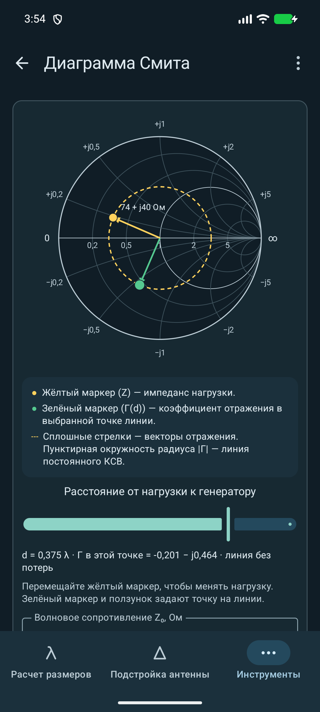
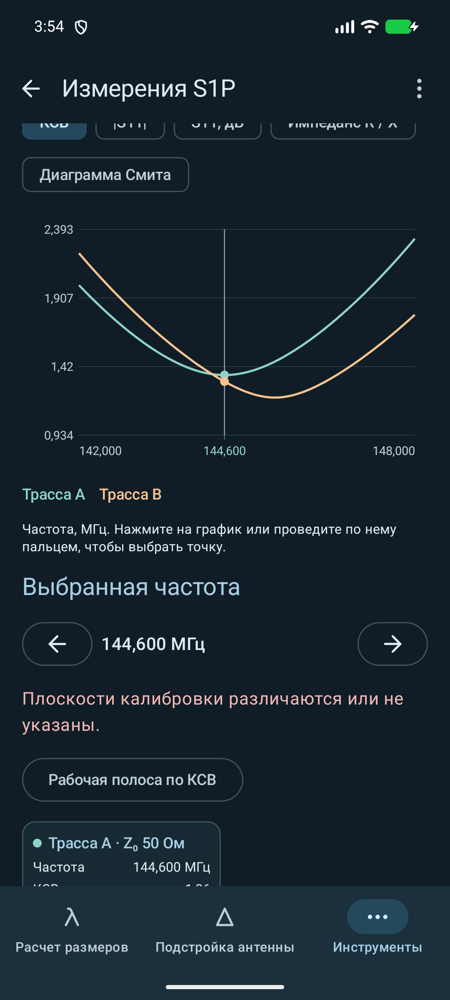
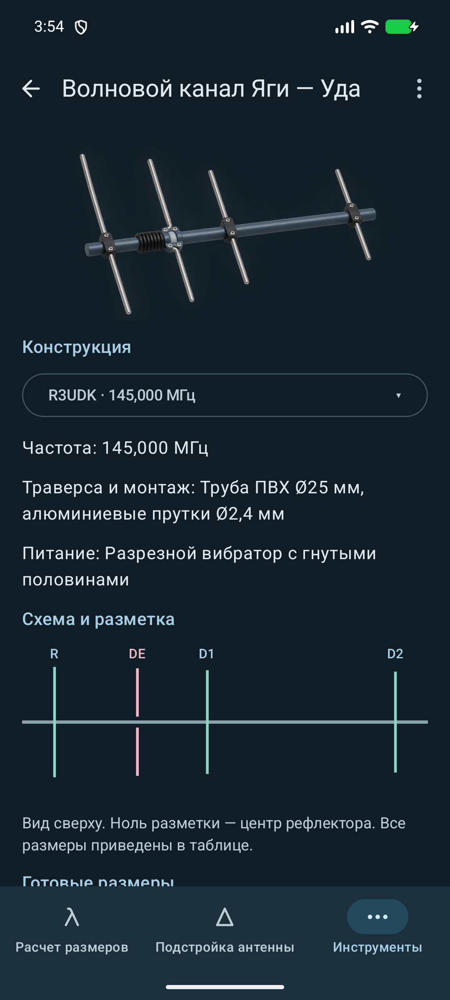
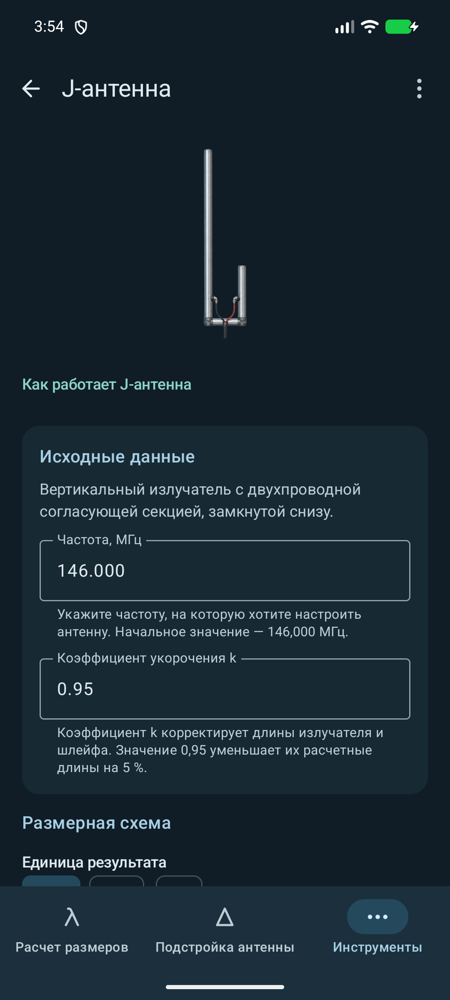
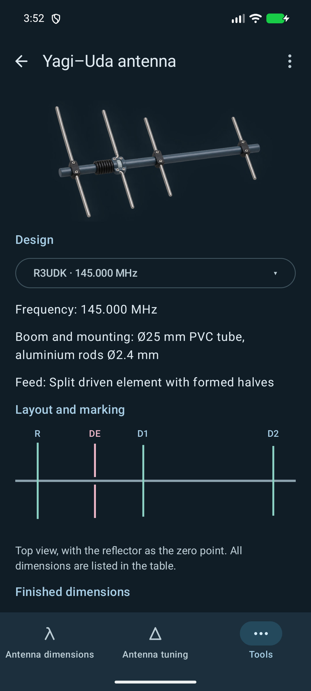
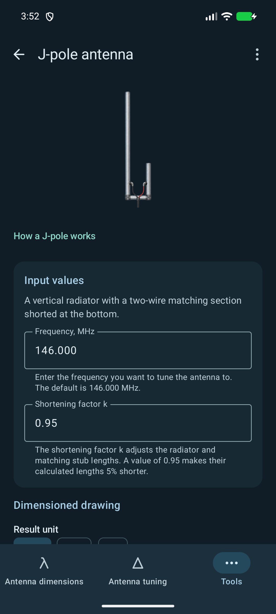

# Antenna Calculator · Антенный калькулятор

[Русский](#русский) · [English](#english)

## Русский

  
  
  

  
  

Антенный калькулятор помогает подобрать начальные размеры антенны, подстроить её по измеренной резонансной частоте и рассчитать параметры согласования и кабеля. Работает на Android 8.0 и новее.

[Скачать antcalc.apk](https://github.com/ssotnikov/antcalc/releases/latest/download/antcalc.apk) · [История версий](https://github.com/ssotnikov/antcalc/releases)

### Возможности

- **Размеры и подстройка.** Рассчитывайте начальную длину штыря и диполя и оценивайте изменение длины по измеренному резонансу.
- **Калькуляторы антенн.** «Перевёрнутая V», Ground Plane, полноволновая рамка (Quad и Delta Loop), J-антенна, Slim Jim и каталоги конструкций Яги — Уда и Моксон. Для Моксона также доступен расчёт размеров по частоте и диаметру.
- **Конструирование.** Иллюстрированное руководство по сборке четырёхэлементной Яги — Уда.
- **КСВ и диаграмма Смита.** Пересчитывайте КСВ, отражение и возвратные потери. Изучайте влияние нагрузки на мощность передатчика и перемещайте маркеры на интерактивной диаграмме.
- **Фидер.** Рассчитывайте электрическую длину, задержку и затухание кабеля по встроенному каталогу или своим данным.
- **Измерения VNA.** Импортируйте и сравнивайте две трассы Touchstone S1P. Просматривайте КСВ, импеданс и диаграмму Смита, определяйте рабочую полосу по порогу КСВ.
- **Проекты и журналы подстройки.** Храните расчеты, замеры, трассы и фото с комментариями. Сравнивайте записи, переносите проекты в JSON и экспортируйте фото в ZIP. [Демо-проект](examples/demo-dipole-journal-145mhz-ru.json) · [S1P до подстройки](examples/demo-dipole-145mhz-before.s1p) · [S1P после подстройки](examples/demo-dipole-145mhz-after.s1p).

Расчеты, формулы и схемы доступны офлайн. В настройках можно выбрать русский или английский язык, светлую, тёмную или системную тему. В версии GitHub Direct обновления доступны из меню приложения.

### Лицензии

[LICENSE.md](LICENSE.md) · Код приложения распространяется по лицензии MIT.

В проекте используются материалы из публикаций следующих авторов и изданий.

- **R3UDK** — [Изготовление антенны «Волновой канал»](https://wiki.app.lizaalert.ru/s/8a0ac7fb-4e86-4453-8778-5a45f9f0ca3e)
- **Хартмут Клювер (DG7YBN)** — [YBN 2-5m](https://www.dg7ybn.de/144MHz/144_5elem.htm) · [GTV 2-6m](https://www.dg7ybn.de/144MHz/144_GTV2_6m.htm)

  Права на оригинальные конструкции сохраняются за автором. Для перепубликации требуется его письменное разрешение. [Условия DG7YBN](https://www.dg7ybn.de/)

- **Мартин Штайер (DK7ZB)** — [3-Element 2 m Yagi](https://dk7zb.darc.de/PVC-Yagis/3-Ele-2m.htm) · [5-Element 70 cm Yagis (28 и 50 Ом)](https://dk7zb.darc.de/70cm/5.htm) · [Duoband Yagi 2 m / 70 cm (2+2)](https://dk7zb.darc.de/Duoband/duoband_2-70_2-3.htm)

  Приведены данные конструкций для некоммерческого использования. По опубликованным условиям автора коммерческое использование требует его разрешения. [Условия DK7ZB](https://dk7zb.darc.de/)

- **Хосе И. Кальдерон (DU1ANV)** — [Build the Slim JIM Antenna](https://www.qsl.net/n1ea/slimjim_du1anv.pdf)
- **Джон (M0UKD)** — [Slim Jim and J Pole Calculator](https://m0ukd.com/calculators/slim-jim-and-j-pole-calculator/) · [1/4 Wave Ground Plane Antenna Calculator](https://m0ukd.com/calculators/quarter-wave-ground-plane-antenna-calculator/)
- **Стив Николс (G0KYA)** — [10m Slim Jim Antenna](https://www.infotechcomms.co.uk/downloads/10m_Slim_Jim.pdf) · [Заметки автора о пересчёте размеров и сборке OH2EUU](https://g0kya.blogspot.com/2011/08/10m-slim-jim-antenna.html)
- **Эли Ково (4X4LH)** — [The 4X4 Slimtenna](https://www.iarc.org/wp-content/uploads/2025/04/2007-06.pdf#page=59)
- **Л. Б. Себик (W4RNL)** — [Some J-Poles That I Have Known, Part 1](https://antenna2.github.io/cebik/content/vhf/jp1.html) · [What Is a Slim Jim?](https://antenna2.github.io/cebik/content/vhf/sj.html)
- **Имон Скелтон (EI9GQ)** — [J-vertical Antenna for 10 Meters Band](https://www.iw5edi.com/ham-radio/6250/j-vertical-antenna-for-10-meters-band)
- **Дейл Хант (WB6BYU)** — [Theory of Full Wave Loops](https://practicalantennas.com/theory/loop/full-wave/)
- **«Радиосхемы» (RadioSkot)** — [Интерактивная диаграмма Смита](https://radioskot.com/calc/interaktivnaya-diagramma-smita)
- **Кьяра Рамелла, Паоло Колантонио и Марко Пирола** — [A Comprehensive Harmonic Analysis of Current-Mode Power Amplifiers](https://www.mdpi.com/1996-1073/14/21/7042)

#### Источники калькулятора «Антенна Моксон»

- **Л. Б. Себик (W4RNL)** — [Designing Moxon Rectangles by Equation and by Model](https://antenna2.github.io/cebik/content/moxon/moxgen.html) · [Building a 2-Meter Moxon](https://antenna2.github.io/cebik/content/moxon/moxbld.html) · [A Truly Portable Moxon Rectangle](https://antenna2.github.io/cebik/content/moxon/20moxp.html) · [The Moxon Rectangle: A Review](https://www.antentop.org/w4rnl.001/mox20.html) · [Mastering Some Mysteries of 2-Element Beams, Part 2](https://antenna2.github.io/cebik/content/fdim/fdim7.html)

  Данные предоставлены автором для личного использования. Условия публикации приведены в оригиналах.
- **Lee Lumpkin (KB8WEV), Bob Cerreto (WA1FXT)** — [A Compact Two-Element 2-Meter Beam](https://www.qsl.net/k/kd8nxh/Tech%20Articles--%20From%20KB3JQQ.com/Tech%20Articles/A%20Compact%20Two-Element%202-Meter%20Beam.pdf).
- **J. Barry Shackleford (W6YE)** — [Moxon Mighty Mite](https://www.arrl.org/files/file/QST%20Binaries/Oct2011/QS1011ShacklefordRev2.pdf).
- **W1CDN** — [70 cm Moxon Antenna](https://w1cdn.net/2024/09/70-cm-moxon-antenna/).
- **A. W. Baker (KG4JJH)** — [6 Meter Moxon Rectangle](https://moxonantennaproject.net/6m%20Moxon%20drawings%20in%20Acrobat%20format.pdf).
- **Ross (G6GVI)** — [A Moxon Rectangle Antenna for 4 m](https://www.qsl.net/g6gvi/4m_Moxon.pdf).
- **Henry HPSD (19DX348)** — [2el Moxon for CB](https://cb-antennas.com/wire-antennas/2el-moxon/).
- **Andreas (Krampfader)** — [Moxon-Richtantenne für CB-Funk](https://antennenbau.dxfreun.de/krampfader/moxon.php).
- **Ignacio (EA2BD)** — [Antena Moxon para 20 m](https://ea2bd.ure.es/archives/EA2BD_Moxon_20m.pdf).
- **George Smart (M1GEO), G8OCV** — [Dual Band Satellite Yagi](https://www.george-smart.co.uk/antennas/dual_band_satellite_yagi/).
- **3dMikL** — [Antena Moxon 868 MHz](https://www.printables.com/model/1682076-antena-moxon-868-mhz). Печатная модель отмечена как Public Domain.
- **Tim (G5OLD / M7TSU/P)** — [10 m Lightweight Moxon](https://www.printables.com/model/768035-10m-lightweight-moxon?lang=de). Печатные детали — CC BY 4.0.
- **Barry Shaffer** — [YAMA 2.0](https://github.com/barryshaffer/YAMA). Репозиторий конструкции — GPL-3.0.

Права на оригинальные конструкции и материалы сохраняются за их авторами и правообладателями. Условия коммерческого и некоммерческого использования определяются правообладателями и указаны в оригинальных публикациях.

### Обратная связь

Чтобы сообщить об ошибке, выберите «Сообщить об ошибке» в меню или настройках. Для связи в Telegram выберите «Связаться с автором» в меню.

В русскоязычном интерфейсе GitHub Direct кнопка «Поддержать автора» в настройках и одноимённый пункт меню открывают страницу добровольного перевода через СБП в Ozon Банке.

[GitHub Issues](https://github.com/ssotnikov/antcalc/issues) ·
[ssotnikov.pro](https://ssotnikov.pro) ·
[ssotnikov@gmail.com](mailto:ssotnikov@gmail.com)

## English

  
  
  

  
  

Antenna Calculator helps you estimate antenna dimensions, adjust an antenna using its measured resonant frequency, and calculate matching and cable parameters. It runs on Android 8.0 or later.

[Download antcalc.apk](https://github.com/ssotnikov/antcalc/releases/latest/download/antcalc.apk) · [Release history](https://github.com/ssotnikov/antcalc/releases)

### Features

- **Antenna sizing and tuning.** Estimate monopole and dipole lengths and work out how much to adjust an antenna using its measured resonance.
- **Antenna calculators.** Inverted-V dipole, ground plane, full-wave loop (Quad and Delta Loop), J-pole, Slim Jim, and Yagi–Uda and Moxon design catalogs. The Moxon calculator also gives dimensions by frequency and conductor diameter.
- **Antenna construction.** An illustrated guide to building a four-element Yagi–Uda.
- **SWR and Smith chart.** Convert between SWR, reflection and return loss. Explore how the load affects transmitter power and drag markers on the interactive chart.
- **Feedlines.** Calculate cable electrical length, delay and attenuation using the built-in cable catalog or your own data.
- **VNA measurements.** Import and compare two Touchstone S1P traces. View SWR, impedance and Smith chart plots, and find the bandwidth for a given SWR threshold.
- **Projects and tuning journals.** Keep calculations, measurements, traces and annotated photos. Compare entries, transfer projects as JSON, and export photos as ZIP. [Demo project](examples/demo-dipole-journal-145mhz-en.json) · [Before tuning (S1P)](examples/demo-dipole-145mhz-before.s1p) · [After tuning (S1P)](examples/demo-dipole-145mhz-after.s1p).

Calculations, formulas and diagrams are available offline. Choose English or Russian and a light, dark or system theme in Settings. The GitHub Direct build can check for updates from the app menu.

### Licenses

[LICENSE.md](LICENSE.md) · The app’s source code is licensed under the MIT License.

The project draws on materials from the following authors and publishers.

- **R3UDK** — [Building a Yagi–Uda Antenna (Russian original)](https://wiki.app.lizaalert.ru/s/8a0ac7fb-4e86-4453-8778-5a45f9f0ca3e)
- **Hartmut Klüver (DG7YBN)** — [YBN 2-5m](https://www.dg7ybn.de/144MHz/144_5elem.htm) · [GTV 2-6m](https://www.dg7ybn.de/144MHz/144_GTV2_6m.htm)

  The author retains the rights to the original designs and requires written permission for republication. [DG7YBN’s terms](https://www.dg7ybn.de/)

- **Martin Steyer (DK7ZB)** — [3-Element 2 m Yagi](https://dk7zb.darc.de/PVC-Yagis/3-Ele-2m.htm) · [5-Element 70 cm Yagis (28 and 50 Ω)](https://dk7zb.darc.de/70cm/5.htm) · [Duoband Yagi 2 m / 70 cm (2+2)](https://dk7zb.darc.de/Duoband/duoband_2-70_2-3.htm)

  Design data are provided for non-commercial use. The author’s published terms require his permission for commercial use. [DK7ZB’s terms](https://dk7zb.darc.de/)

- **Jose I. Calderon (DU1ANV)** — [Build the Slim JIM Antenna](https://www.qsl.net/n1ea/slimjim_du1anv.pdf)
- **John (M0UKD)** — [Slim Jim and J Pole Calculator](https://m0ukd.com/calculators/slim-jim-and-j-pole-calculator/) · [1/4 Wave Ground Plane Antenna Calculator](https://m0ukd.com/calculators/quarter-wave-ground-plane-antenna-calculator/)
- **Steve Nichols (G0KYA)** — [10m Slim Jim Antenna](https://www.infotechcomms.co.uk/downloads/10m_Slim_Jim.pdf) · [Author’s notes on scaling and the OH2EUU build](https://g0kya.blogspot.com/2011/08/10m-slim-jim-antenna.html)
- **Eli Kovo (4X4LH)** — [The 4X4 Slimtenna](https://www.iarc.org/wp-content/uploads/2025/04/2007-06.pdf#page=59)
- **L. B. Cebik (W4RNL)** — [Some J-Poles That I Have Known, Part 1](https://antenna2.github.io/cebik/content/vhf/jp1.html) · [What Is a Slim Jim?](https://antenna2.github.io/cebik/content/vhf/sj.html)
- **Eamon Skelton (EI9GQ)** — [J-vertical Antenna for 10 Meters Band](https://www.iw5edi.com/ham-radio/6250/j-vertical-antenna-for-10-meters-band)
- **Dale Hunt (WB6BYU)** — [Theory of Full Wave Loops](https://practicalantennas.com/theory/loop/full-wave/)
- **RadioSkot (Радиосхемы)** — [Interactive Smith Chart (Russian original)](https://radioskot.com/calc/interaktivnaya-diagramma-smita)
- **Chiara Ramella, Paolo Colantonio and Marco Pirola** — [A Comprehensive Harmonic Analysis of Current-Mode Power Amplifiers](https://www.mdpi.com/1996-1073/14/21/7042)

#### Moxon calculator sources

- **L. B. Cebik (W4RNL)** — [Designing Moxon Rectangles by Equation and by Model](https://antenna2.github.io/cebik/content/moxon/moxgen.html) · [Building a 2-Meter Moxon](https://antenna2.github.io/cebik/content/moxon/moxbld.html) · [A Truly Portable Moxon Rectangle](https://antenna2.github.io/cebik/content/moxon/20moxp.html) · [The Moxon Rectangle: A Review](https://www.antentop.org/w4rnl.001/mox20.html) · [Mastering Some Mysteries of 2-Element Beams, Part 2](https://antenna2.github.io/cebik/content/fdim/fdim7.html)

  The author permits personal use of the data. See the originals for the republication terms.
- **Lee Lumpkin (KB8WEV), Bob Cerreto (WA1FXT)** — [A Compact Two-Element 2-Meter Beam](https://www.qsl.net/k/kd8nxh/Tech%20Articles--%20From%20KB3JQQ.com/Tech%20Articles/A%20Compact%20Two-Element%202-Meter%20Beam.pdf).
- **J. Barry Shackleford (W6YE)** — [Moxon Mighty Mite](https://www.arrl.org/files/file/QST%20Binaries/Oct2011/QS1011ShacklefordRev2.pdf).
- **W1CDN** — [70 cm Moxon Antenna](https://w1cdn.net/2024/09/70-cm-moxon-antenna/).
- **A. W. Baker (KG4JJH)** — [6 Meter Moxon Rectangle](https://moxonantennaproject.net/6m%20Moxon%20drawings%20in%20Acrobat%20format.pdf).
- **Ross (G6GVI)** — [A Moxon Rectangle Antenna for 4 m](https://www.qsl.net/g6gvi/4m_Moxon.pdf).
- **Henry HPSD (19DX348)** — [2el Moxon for CB](https://cb-antennas.com/wire-antennas/2el-moxon/).
- **Andreas (Krampfader)** — [Moxon-Richtantenne für CB-Funk](https://antennenbau.dxfreun.de/krampfader/moxon.php).
- **Ignacio (EA2BD)** — [Antena Moxon para 20 m](https://ea2bd.ure.es/archives/EA2BD_Moxon_20m.pdf).
- **George Smart (M1GEO), G8OCV** — [Dual Band Satellite Yagi](https://www.george-smart.co.uk/antennas/dual_band_satellite_yagi/).
- **3dMikL** — [Antena Moxon 868 MHz](https://www.printables.com/model/1682076-antena-moxon-868-mhz). The printable model is marked Public Domain.
- **Tim (G5OLD / M7TSU/P)** — [10 m Lightweight Moxon](https://www.printables.com/model/768035-10m-lightweight-moxon?lang=de). The printed parts are licensed under CC BY 4.0.
- **Barry Shaffer** — [YAMA 2.0](https://github.com/barryshaffer/YAMA). The construction repository is licensed under GPL-3.0.

The authors and other rights holders retain the rights to the original designs and materials. See the original publications for their terms of commercial and non-commercial use.

### Contact

To report a bug, choose Report a bug from the menu or Settings. To reach the author on Telegram, choose Contact the author from the menu.

In the Russian interface of the GitHub Direct build, «Поддержать автора» in Settings and the app menu opens Ozon Bank’s page for voluntary transfers via the Faster Payments System (SBP).

[GitHub Issues](https://github.com/ssotnikov/antcalc/issues) ·
[ssotnikov.pro](https://ssotnikov.pro) ·
[ssotnikov@gmail.com](mailto:ssotnikov@gmail.com)

## Project map / Карта проекта

| Area / Область | Location / Путь |
|---|---|
| Formulas, units, parsing / Формулы, единицы, парсер | `calculator-core/src/main/kotlin/local/antenna/calculator/core/` |
| State / Состояние | `app/src/main/kotlin/local/antenna/calculator/state/` |
| Persistence / Хранение | `app/src/main/kotlin/local/antenna/calculator/data/` |
| Screens and gestures / Экраны и жесты | `app/src/main/kotlin/local/antenna/calculator/ui/` |
| Text / Тексты | `app/src/main/res/values/`, `app/src/main/res/values-ru/` |

## License / Лицензия

MIT — [LICENSE.md](LICENSE.md). Copyright © 2026 Sergey Sotnikov.
Third-party components retain their respective licenses.
Лицензии сторонних компонентов сохраняются.
