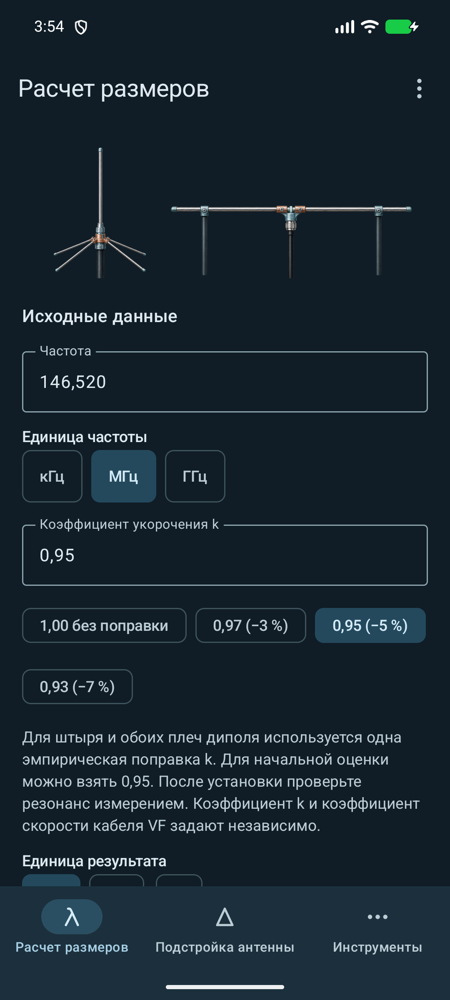
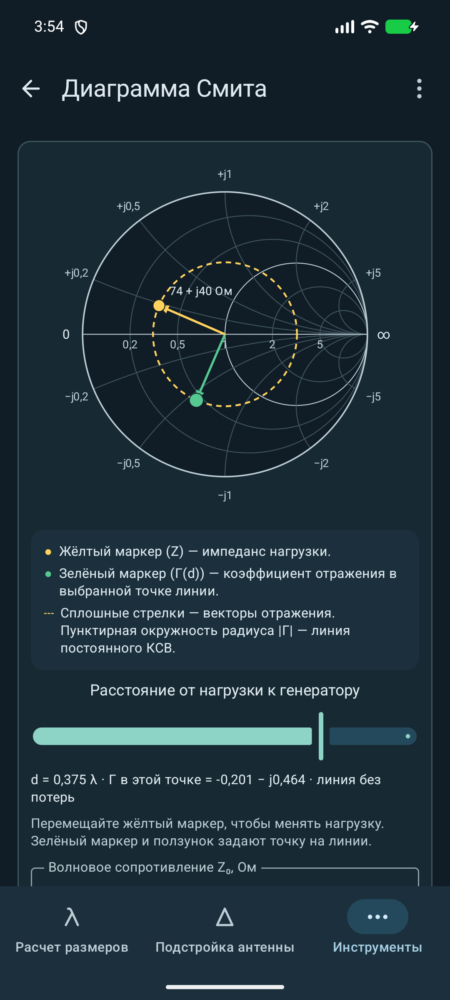
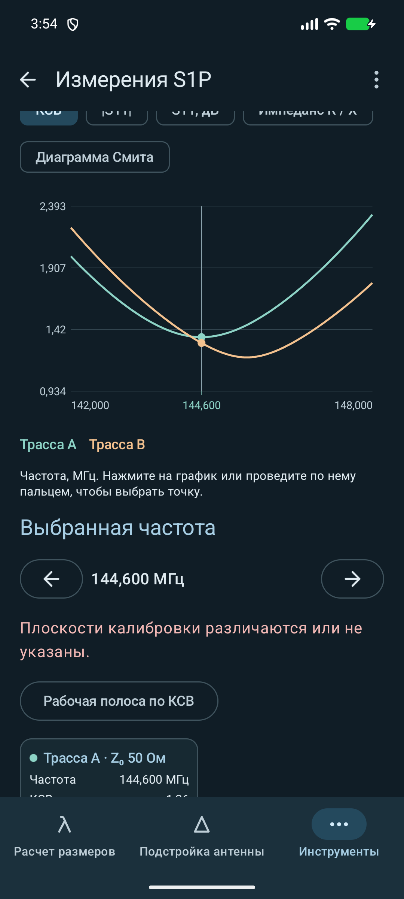
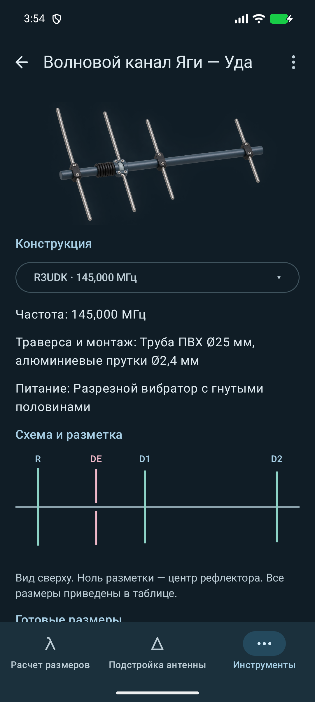
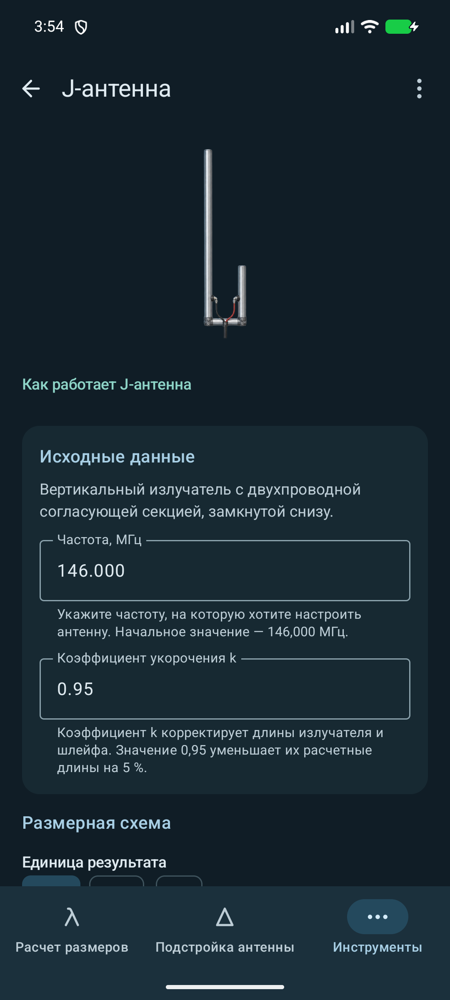
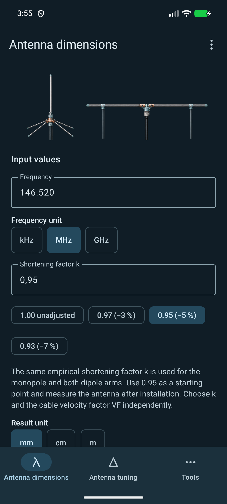
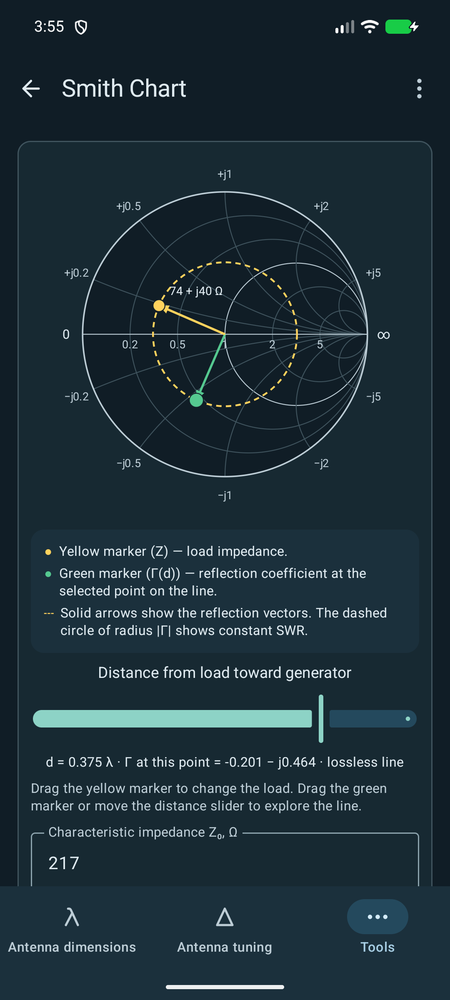
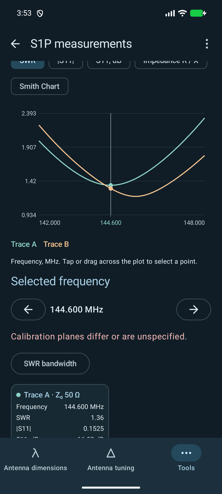
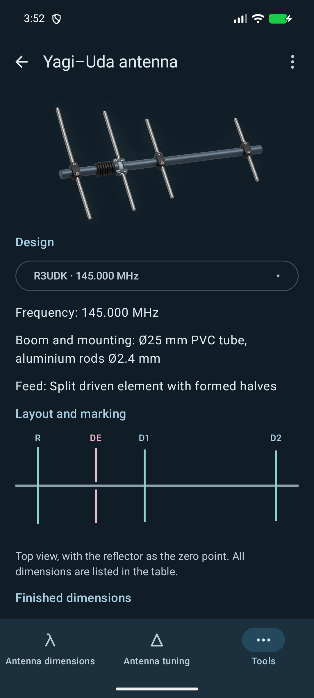
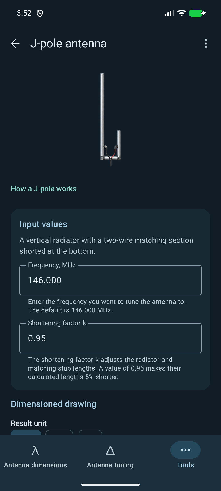

# Antenna Calculator · Антенный калькулятор

[Русский](#русский) · [English](#english)

## Русский

  
  
  

  
  

Антенный калькулятор помогает подобрать начальные размеры антенны, подстроить её по измеренной резонансной частоте и рассчитать параметры согласования и кабеля. Работает на Android 8.0 и новее.

[Скачать antcalc.apk](https://github.com/ssotnikov/antcalc/releases/latest/download/antcalc.apk) · [История версий](https://github.com/ssotnikov/antcalc/releases)

### Возможности

- **Размеры и подстройка.** Рассчитывайте начальную длину штыря и диполя и оценивайте изменение длины по измеренному резонансу.
- **Калькуляторы антенн.** «Перевёрнутая V», Ground Plane, полноволновая рамка (Quad и Delta Loop), J-антенна и каталог конструкций Яги — Уда.
- **Конструирование.** Иллюстрированное руководство по сборке четырёхэлементной Яги — Уда.
- **КСВ и диаграмма Смита.** Пересчитывайте КСВ, отражение и возвратные потери. Изучайте влияние нагрузки на мощность передатчика и перемещайте маркеры на интерактивной диаграмме.
- **Фидер.** Рассчитывайте электрическую длину, задержку и затухание кабеля по встроенному каталогу или своим данным.
- **Измерения VNA.** Импортируйте и сравнивайте две трассы Touchstone S1P. Просматривайте КСВ, импеданс и диаграмму Смита, определяйте рабочую полосу по порогу КСВ.
- **Проекты и журналы подстройки.** Храните расчеты, замеры, трассы и фото с комментариями. Сравнивайте записи, переносите проекты в JSON и экспортируйте фото в ZIP. [Демо-проект](examples/demo-dipole-journal-145mhz-ru.json) · [S1P до подстройки](examples/demo-dipole-145mhz-before.s1p) · [S1P после подстройки](examples/demo-dipole-145mhz-after.s1p).

Расчеты, формулы и схемы доступны офлайн. В настройках можно выбрать русский или английский язык, светлую, тёмную или системную тему. В версии GitHub Direct обновления доступны из меню приложения.

### Обратная связь

Чтобы сообщить об ошибке, выберите «Сообщить об ошибке» в меню или настройках. Для связи в Telegram выберите «Связаться с автором» в меню.

[GitHub Issues](https://github.com/ssotnikov/antcalc/issues) ·
[ssotnikov.pro](https://ssotnikov.pro) ·
[ssotnikov@gmail.com](mailto:ssotnikov@gmail.com)

## English

  
  
  

  
  

Antenna Calculator helps you estimate antenna dimensions, adjust an antenna using its measured resonant frequency, and calculate matching and cable parameters. It runs on Android 8.0 or later.

[Download antcalc.apk](https://github.com/ssotnikov/antcalc/releases/latest/download/antcalc.apk) · [Release history](https://github.com/ssotnikov/antcalc/releases)

### Features

- **Antenna sizing and tuning.** Estimate monopole and dipole lengths and work out how much to adjust an antenna using its measured resonance.
- **Antenna calculators.** Inverted-V dipole, ground plane, full-wave loop (Quad and Delta Loop), J-pole, and a Yagi–Uda design catalog with a cut list for the R3UDK model.
- **Antenna construction.** An illustrated guide to building a four-element Yagi–Uda.
- **SWR and Smith chart.** Convert between SWR, reflection and return loss. Explore how the load affects transmitter power and drag markers on the interactive chart.
- **Feedlines.** Calculate cable electrical length, delay and attenuation using the built-in cable catalog or your own data.
- **VNA measurements.** Import and compare two Touchstone S1P traces. View SWR, impedance and Smith chart plots, and find the bandwidth for a given SWR threshold.
- **Projects and tuning journals.** Keep calculations, measurements, traces and annotated photos. Compare entries, transfer projects as JSON, and export photos as ZIP. [Demo project](examples/demo-dipole-journal-145mhz-en.json) · [Before tuning (S1P)](examples/demo-dipole-145mhz-before.s1p) · [After tuning (S1P)](examples/demo-dipole-145mhz-after.s1p).

Calculations, formulas and diagrams are available offline. Choose English or Russian and a light, dark or system theme in Settings. The GitHub Direct build can check for updates from the app menu.

### Contact

To report a bug, choose Report a bug from the menu or Settings. To reach the author on Telegram, choose Contact the author from the menu.

[GitHub Issues](https://github.com/ssotnikov/antcalc/issues) ·
[ssotnikov.pro](https://ssotnikov.pro) ·
[ssotnikov@gmail.com](mailto:ssotnikov@gmail.com)

## Project map / Карта проекта

| Area / Область | Location / Путь |
|---|---|
| Formulas, units, parsing / Формулы, единицы, парсер | `calculator-core/src/main/kotlin/local/antenna/calculator/core/` |
| State / Состояние | `app/src/main/kotlin/local/antenna/calculator/state/` |
| Persistence / Хранение | `app/src/main/kotlin/local/antenna/calculator/data/` |
| Screens and gestures / Экраны и жесты | `app/src/main/kotlin/local/antenna/calculator/ui/` |
| Text / Тексты | `app/src/main/res/values/`, `app/src/main/res/values-ru/` |

## License / Лицензия

MIT — [LICENSE.md](LICENSE.md). Copyright © 2026 Sergey Sotnikov.
Third-party components retain their respective licenses.
Лицензии сторонних компонентов сохраняются.
